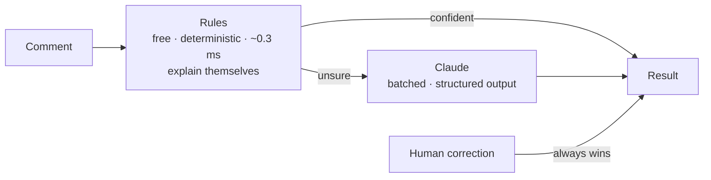

# hybrid-review-classifier

Triage player reviews and comments with fast local rules, and let **Claude** look only at the ones the rules aren't sure about.

Each comment gets a **category** (bug, question, praise, suggestion, complaint, spam, toxic, other), a **sentiment**, a **priority**, its **language**, a **confidence**, and the **evidence** behind the decision, down to the exact words in the text.

```
$ npm run demo

ID    CATEGORY    SENTIMENT PRIORITY CONF  BY     COMMENT
r1    bug         negative  high     1.00  rules  Crashes to desktop every time I load my save after chapter 3. Lost …
r2    praise      positive  low      1.00  rules  No bugs, runs great on the Steam Deck and the soundtrack is a bange…
r3    bug         positive  medium   0.72  rules  Great art, but the game freezes every time I open the map.
r4    suggestion  neutral   low      0.85  rules  Would be perfect with online co-op 🙏
r6    complaint   negative  low      1.00  rules  Best game ever. Totally worth the $30 for 2 hours of content.
r7    bug         positive  medium   0.65  rules  Está la raja, me tiene enganchado jajaja. Eso sí, se pega un poco e…
r8    complaint   negative  medium   1.00  rules  Muy fome y repetitivo, no vale la pena a ese precio. Esperen una of…
r9    spam        neutral   low      0.94  rules  🔥 FREE SKINS 🔥 check out my channel, link in bio
r13   other       neutral   low      0.21  rules  Crab.
r14   other       neutral   low      0.21  rules  Das Spiel ist wunderschön, aber viel zu kurz.
…
2 below confidence 0.6: add --ai to let Claude take a look at those.
```

It is a simplified, open-source version of the classifier I built for the internal dashboard of my indie studio, [NEOINIT GAMES](https://neoinitgames.com).

## Why hybrid

A small studio gets hundreds of comments a week across Steam, YouTube, Discord and Reddit. Reading them all is slow, and sending every one to an LLM costs money for comments that are obvious ("Crashes on launch, black screen").

So the work is split:



The rules handle the clear cases and, just as important, **know when they don't know**. On comments they have never seen, they are right 68% of the time when confident and 48% when not (details in [Measured honestly](#measured-honestly)). The unsure ones go to Claude.

## Quick start

Requires Node 22.12+.

```bash
git clone https://github.com/jltorocode/hybrid-review-classifier
cd hybrid-review-classifier
npm install
npm run demo                                     # rules only, with the evidence
```

With Claude:

```bash
export ANTHROPIC_API_KEY=sk-ant-...              # or `ant auth login`
npm run classify -- examples/reviews.json --ai --explain
```

Input is a JSON array of `{ id?, text, source?, recommended?, helpfulVotes? }`, or a `.txt` file with one comment per line.

| Option | What it does |
|---|---|
| `--explain` | Shows each comment with its evidence highlighted, and the reasons. |
| `--ai` | Sends the comments below the confidence threshold to Claude. |
| `--all` | With `--ai`, sends every comment (except manual corrections). |
| `--threshold <n>` | Confidence below which a comment goes to Claude. Default `0.6`. |
| `--budget <tokens>` | Stops calling Claude after this many tokens. |
| `--corrections <file>` | Human corrections, which always win. See [below](#humans-have-the-last-word). |
| `--json` | Prints JSON instead of a table. |

As a library (from a clone):

```ts
import { classifyWithRules, claudeModel, refineWithClaude } from './src';

const results = reviews.map(classifyWithRules);
const report = await refineWithClaude(reviews, results, { callModel: claudeModel(), tokenBudget: 50_000 });
```

```jsonc
// One result
{
  "id": "r3",
  "sentiment": "positive",
  "category": "bug",
  "priority": "medium",
  "language": "en",
  "confidence": 0.72,
  "classifiedBy": "rules",           // rules | ai | manual
  "reasons": ["praise: \"Great\" (before \"but\": weighs less)", "bug: \"freezes\" (after \"but\": weighs more)"],
  "evidence": [{ "start": 24, "end": 31, "text": "freezes", "signal": "bug" }]
}
```

## How the rules decide

- **Visible text only.** In Steam "template" reviews (☐ Bad ☑ Beautiful), only the ticked boxes count.
- **Lexicons in English and Spanish**, with gamer slang and Chilean, Argentine and Mexican expressions ("la raja", "fome", "se pega", "bacán"). Where two terms overlap, the longer one wins: "not worth it" beats "worth it".
- **Shapes, not just words:** scores like `9/10` or ★★★★☆, price per hour of play ("$30 for 2 hours"), leaked text keys (`STR_MENU_START`), and links, including the ones written to dodge filters ("keys dot shop").
- **Context inside each clause:** negation ("no bugs", "sin lag"), intensifiers, contrast (what comes after "but" weighs more), concession ("at least the music…"), mitigation ("crashed once"), and wishes ("would be perfect with co-op" is a suggestion, not praise).
- **Steam's thumb** counts only when the text gives an opinion. Praise with a thumbs down reads as sarcasm, complaints with a thumbs up read as a mixed review, and "I clicked no by mistake" flips it.
- **Category:** toxic, spam, bug and question each have their own bar, checked in that order. A concrete bug report counts as a bug even inside a glowing review, because someone has to fix it. Everything else is decided by weight.
- **Priority** is high for crashes, games that won't start, lost progress, payment problems and threats. Negative reviews with 20+ helpful votes go up a level, because those are the ones shoppers read.
- **Offsets are preserved.** Folding accents happens one character at a time, so evidence always points at the original words ("buenísimo", not "buenisimo").

## How Claude is used

The integration lives in [`src/llm/`](src/llm) and uses the official [Anthropic SDK](https://github.com/anthropics/anthropic-sdk-typescript).

- **Only what's needed.** By default, only comments below the confidence threshold are sent, in batches of 20 with short keys (`c1`, `c2`…) that are mapped back. If an answer gets cut by `max_tokens`, the batch is split in half and retried.
- **Structured outputs.** The response is constrained with a hand-written JSON Schema, so the enums reach the API and the model can't invent a category. It is validated again with Zod before use.
- **Player text is data, never instructions.** Each comment is wrapped in a `<comment>` tag, any attempt to close the tag is escaped, attribute values are sanitized, and the system prompt says so. There is a test for it.
- **No invented evidence.** Claude quotes the words behind each decision. Quotes that don't appear in the comment are dropped and reported.
- **Cost under control.** Low effort (classification doesn't need deep reasoning), a token budget, and usage plus estimated cost after every run.
- **Resilient.** The SDK retries rate limits and server errors. If a safety classifier declines a batch, server-side fallbacks retry it on another model in the same call. If a request fails anyway, the rules' answer stays.
- **Model:** `claude-opus-5-5` by default. Set `CLAUDE_MODEL` to use another current model that supports effort and server-side fallbacks.

## Humans have the last word

```json
[{ "id": "r13", "category": "praise" }]
```

```bash
npm run classify -- examples/reviews.json --corrections my-fixes.json --ai
```

A corrected comment is marked `manual`. It is never sent to Claude and never overwritten. `keepManual()` applies the same rule when you store results in your own database.

## Measured honestly

`eval/` has 170 hand-labeled comments in English and Spanish, in two sets of 85. They come from a private project, where an AI agent wrote and labeled them without seeing any rules. Set B was written to avoid the obvious words (for example, "it kicks me back to the desktop" instead of "crash"). The rules in this repo were written **without looking at either set**. Then they were tuned **only on set A**, and set B was kept aside as the test.

| Category accuracy, rules only | Set A | Set B (held out) |
|---|---|---|
| Before tuning (both blind) | 67.1% | 54.1% |
| After tuning on set A | 96.5% * | **62.4%** |

| Set B (held out), after tuning | Category | Sentiment | Priority | Language |
|---|---|---|---|---|
| Rules only | 62.4% | 72.9% | 78.8% | 94.1% |
| Confident (60 of 85) vs. not | 68.3% vs. 48.0% | | | |

\* Set A after tuning is a regression test, not a promise.

The number that describes new comments is set B's: **the rules alone get roughly six out of ten categories right**. That is why they don't work alone. Their confidence tells you which answers to trust, which is what makes it cheap to send only the rest to Claude.

To measure rules + Claude with your own key (about 50 comments are sent, well under a dollar):

```bash
npm run eval -- --ai
npm run eval -- --set a --misses   # every wrong category, with the text and the reasons
```

## Limitations

- The rules cover English and Spanish only. Everything else is marked `und` with low confidence and left to Claude.
- The lexicons were tuned on 85 comments. Expect misses on slang and phrasings they haven't seen; `--explain` shows why each decision was made.
- The tests cover the Claude path with a fake model, and the numbers above are rules only. Run the eval with `--ai` to see the hybrid on your own data.

## Development

```bash
npm test             # vitest
npm run typecheck    # tsc
npm run eval         # accuracy and confusion matrix
```

```
src/
  rules.ts          the rules engine
  lexicon/          English and Spanish terms, negators, intensifiers…
  patterns.ts       scores, stars, links, price per hour, emoji
  normalize.ts      offset-preserving folding and clause splitting
  language.ts       English / Spanish detection
  llm/              prompt, JSON schema and batched refinement with Claude
  merge.ts          human corrections
  cli.ts
eval/               labeled sets and the evaluation script
test/
```

## License

MIT © [José Toro](https://jltorocode.com)
